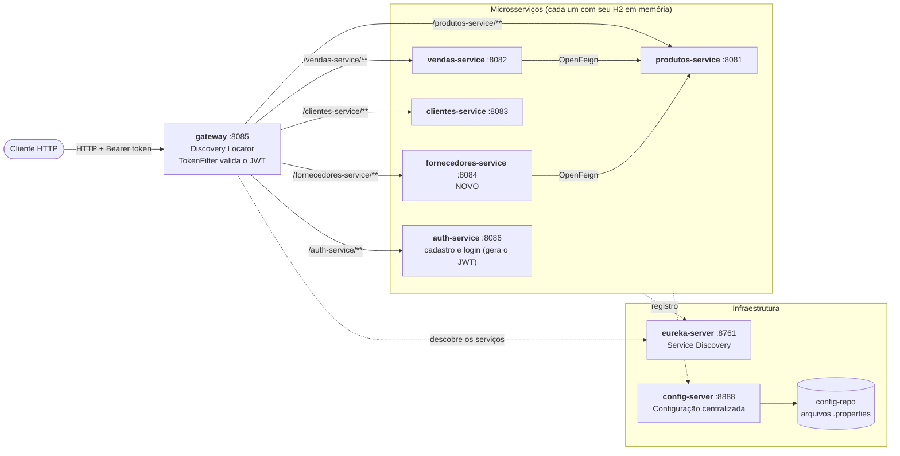

# API Vendas: microsserviços com Spring Cloud

Projeto da disciplina de Microsserviços e DevOps, baseado no `api-vendas` (branch `v10`), acrescido do novo **`fornecedores-service`**, que se integra ao Eureka, ao Config Server, ao Gateway, ao `produtos-service` (via OpenFeign), ao Docker Compose e a um workflow de GitHub Actions.

## Arquitetura



O **Gateway** é a única porta de entrada. Ele descobre os serviços pelo nome registrado no Eureka (sem rotas escritas à mão) e, antes de repassar qualquer requisição, confere o token JWT no `TokenFilter`. Só o cadastro e o login do `auth-service` passam sem token. Os serviços de domínio não fazem autenticação: a validação acontece toda no Gateway. A chamada Feign entre serviços é interna à rede e vai direto ao `produtos-service`, achado pelo Eureka.

| Serviço | Porta | Papel |
|---|---|---|
| `eureka-server` | 8761 | Service discovery |
| `config-server` | 8888 | Configuração centralizada (`config-repo`) |
| `produtos-service` | 8081 | Catálogo de produtos |
| `vendas-service` | 8082 | Vendas, consulta produtos via Feign |
| `clientes-service` | 8083 | Clientes |
| `fornecedores-service` | 8084 | Fornecedores, consulta produtos via Feign |
| `gateway` | 8085 | Porta de entrada e validação do JWT |
| `auth-service` | 8086 | Cadastro e login (emite o JWT) |

## fornecedores-service

Criado a partir do `clientes-service`. A porta `8084`, o H2 e o Eureka vêm do Config Server (`config-repo/fornecedores-service.properties` e `fornecedores-service-docker.properties`); o `application.properties` local só tem o nome da aplicação e o endereço do Config Server.

A entidade `Fornecedor` tem `id` gerado pelo banco, `nome` obrigatório e `cnpj` obrigatório e único. Cinco fornecedores são criados no H2 quando a aplicação sobe.

| Método | Rota | Resposta |
|---|---|---|
| `GET` | `/fornecedores` | Lista todos |
| `GET` | `/fornecedores/{id}` | O fornecedor, ou **404** se não existir |
| `POST` | `/fornecedores` | **201** com o fornecedor criado (**400** sem nome/CNPJ, **409** se o CNPJ já existir) |
| `GET` | `/fornecedores/produtos` | Produtos obtidos do `produtos-service` via OpenFeign |

Pelo Gateway, o nome do serviço vira prefixo: `http://localhost:8085/fornecedores-service/fornecedores`.

## Como executar

Pré-requisito: Docker em execução.

```bash
docker compose up --build
```

O compose só inicia os serviços depois que o `eureka-server` e o `config-server` estão saudáveis. Em cerca de um minuto todos aparecem em <http://localhost:8761>.

Sem Docker, cada serviço é um projeto Maven independente: suba `eureka-server` e `config-server` primeiro, depois os demais com `mvn spring-boot:run` dentro da pasta de cada um.

## Como testar pelo Gateway

O Gateway exige token em tudo, exceto cadastro e login. Primeiro obtenha o token:

```bash
curl -X POST http://localhost:8085/auth-service/usuarios \
  -H "Content-Type: application/json" \
  -d '{"nome":"Aluno","email":"aluno@teste.com","senha":"senha123"}'

TOKEN=$(curl -s -X POST http://localhost:8085/auth-service/usuarios/login \
  -H "Content-Type: application/json" \
  -d '{"email":"aluno@teste.com","senha":"senha123"}')
```

Depois use o token nas rotas de fornecedores:

```bash
# lista (5 fornecedores iniciais)
curl http://localhost:8085/fornecedores-service/fornecedores -H "Authorization: Bearer $TOKEN"

# por id (200) e id inexistente (404)
curl -i http://localhost:8085/fornecedores-service/fornecedores/1  -H "Authorization: Bearer $TOKEN"
curl -i http://localhost:8085/fornecedores-service/fornecedores/99 -H "Authorization: Bearer $TOKEN"

# criar (201)
curl -i -X POST http://localhost:8085/fornecedores-service/fornecedores \
  -H "Authorization: Bearer $TOKEN" -H "Content-Type: application/json" \
  -d '{"nome":"Nova Fornecedora Ltda","cnpj":"67.890.123/0001-20"}'

# produtos do produtos-service, via Feign
curl http://localhost:8085/fornecedores-service/fornecedores/produtos -H "Authorization: Bearer $TOKEN"
```

Sem o header `Authorization`, o Gateway responde **401**. Para acessar o serviço direto, sem Gateway e sem token (útil em desenvolvimento): <http://localhost:8084/fornecedores>. Configuração servida pelo Config Server: <http://localhost:8888/fornecedores-service/default>. Console do H2: <http://localhost:8084/h2-console> (JDBC URL `jdbc:h2:mem:fornecedoresdb`, usuário `sa`, sem senha).

## GitHub Actions

O workflow `.github/workflows/fornecedores-service.yml` roda a cada `push`: faz o checkout, configura o Java 17 (Temurin) e compila o `fornecedores-service` com `mvn -B package`. Não há etapa de deploy.

## Decisão: porta do auth-service

O `auth-service` já usava a porta `8084` na `v10`, a mesma exigida para o `fornecedores-service`. Para os dois conviverem, o `auth-service` passou para a `8086` (`config-repo/auth-service.properties`, `Dockerfile` e `docker-compose.yml`). O acesso pelo Gateway não muda, porque ele chega ao auth pelo nome no Eureka. Os manifests de `k8s/` não foram alterados: lá cada serviço roda em seu próprio Pod, sem conflito de porta.

## Documentação do projeto

Documentação Microserviços
https://claude.ai/code/artifact/2c541174-0b49-486d-9ee2-1682e91b8daf

Documentação implementação Docker GUIA
https://claude.ai/code/artifact/a5f3c8e5-81de-4791-a16c-a71d4aa45f0f

Documentação implementação Kubernetes GUIA
https://claude.ai/code/artifact/68cd2944-af3d-430f-8e6f-ea27c4186982

Documentação deploy na Oracle Cloud GUIA
https://claude.ai/artifact/71fuEpCrAzrZzCS6kyVzKo

Documentação GitHub Actions (CI/CD) GUIA
https://claude.ai/artifact/F21uNn1PE4FpN3ewMj6Aw6
